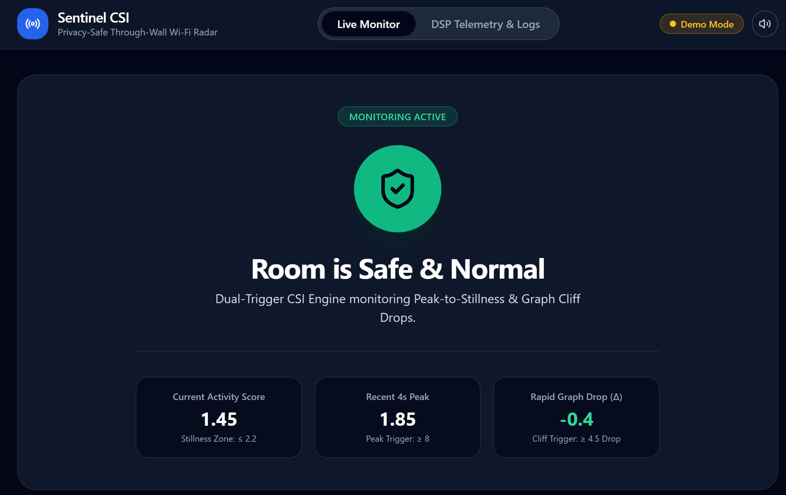

# 📡 Sentinel CSI: Privacy-Safe Through-Wall Wi-Fi Radar

Sentinel CSI is a non-intrusive, camera-free fall detection system that repurposes standard 2.4 GHz Wi-Fi into an invisible RF radar field. By extracting Channel State Information (CSI) directly from the physical layer of two ESP32 microcontrollers, the system analyzes OFDM subcarrier distortion caused by human movement in real-time. 


*Live Dashboard showing the state machine and dual-trigger metrics.*

## 🚀 How It Works
1. **Hardware:** A Transmitter (TX) ESP32 emits a steady 2.4 GHz Wi-Fi signal. A Receiver (RX) ESP32 captures the signal and extracts the raw CSI multipath data.
2. **DSP Pipeline (70Hz):** A Python-based backend applies a Butterworth High-Pass filter to strip out ambient room noise and slow movements, isolating high-velocity kinetic impacts.
3. **Detection Engine:** The system measures the mathematical variance of the signal to generate a clean "Activity Score."
4. **Live Telemetry:** Data is streamed via full-duplex WebSockets to a React/Tailwind frontend with zero latency.


*High-Pass Filtered Energy vs. Adaptive EMA Threshold.*

## 🛠️ Project Evolution & What Finally Worked
Since the first draft of this project, the codebase underwent significant architectural and mathematical upgrades to achieve live, exhibition-ready stability:

* **From Offline to Live:** We consolidated five separate offline research scripts into a single, unified `backend_server.py` powered by FastAPI and WebSockets.
* **1D Spatial Averaging:** We initially tracked 5 subcarriers independently, which proved too susceptible to hardware noise. We shifted to a 1D spatial averaging approach *before* running the variance math, effectively smoothing out ESP32 baseline noise while maintaining sensitivity to human falls.
* **The Dual-Trigger State Machine:** The ultimate breakthrough for accurate detection was implementing a two-pronged approach:
  * **Trigger 1 (Peak + Stillness):** Detects a sharp kinetic peak ($\ge 8.0$) immediately followed by a drop into a stillness threshold ($\le 2.2$).
  * **Trigger 2 (Graph Cliff Drop):** A rolling 4-second memory buffer that looks for a sudden "cliff" in the graph (e.g., dropping by at least 4.5 points rapidly). This successfully caught the exact visual signature of a true fall.
* **Environment Execution:** Relying on the ESP-IDF toolchain's Python environment ensured stable, high-baud-rate Serial port connections on Windows. 

---

## 💻 Tech Stack
* **Backend:** Python, FastAPI, WebSockets, SciPy (Signal Processing), NumPy, PySerial
* **Frontend:** React, Vite, Tailwind CSS, Recharts
* **Hardware:** 2x ESP32 Microcontrollers (TX/RX)

---

## ⚙️ Setup & Installation Walkthrough

### Prerequisites
* Python 3.10+
* Node.js (v16+)
* ESP32 Receiver plugged into your machine via USB

### 1. Start the Backend (Python Engine)
Open a terminal and navigate to the `backend` folder. Create a virtual environment, install the DSP dependencies, and start the server.

**On Windows:**
```powershell
cd sentinel-csi/backend
python -m venv .venv
.\.venv\Scripts\activate
pip install -r requirements.txt
python backend_server.py
```
*(Note: If you have the ESP-IDF installed, you can bypass the local venv and run the script directly using the ESP-IDF Python path, e.g., `& "D:\Espressif\tools\python\v5.5.6\venv\Scripts\python.exe" backend_server.py`)*

**On macOS/Linux:**
```bash
cd sentinel-csi/backend
python3 -m venv .venv
source .venv/bin/activate
pip install -r requirements.txt
python3 backend_server.py
```
*You should see a message confirming connection to your COM port or `/dev/cu.*` device.*

### 2. Start the Frontend (React Dashboard)
Open a **second** terminal window and navigate to the `frontend` folder.

```bash
cd sentinel-csi/frontend
npm install
npm run dev
```

### 3. Launch the App
Open your web browser and go to:
**`http://localhost:5173`** 
*(If you encounter localhost IPv6 routing issues on macOS, use `http://127.0.0.1:5173` instead).*

The dashboard will load, the top-right badge will turn green to indicate hardware connection, and the system will immediately begin monitoring the room!
